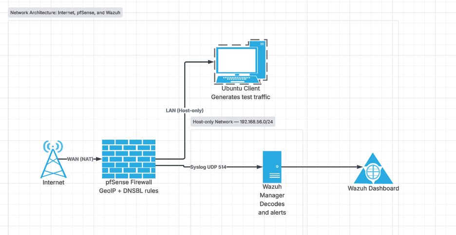

# pfSense and Wazuh SIEM Integration

A hands-on SOC lab where a pfSense firewall blocks traffic by country and by website, and forwards its logs to a Wazuh SIEM that turns those blocks into readable alerts.

I built this during my SOC Analyst internship at ITSOLERA.
Architecture diagram

Full-size diagram and source files: diagram/architecture.png



## What this lab does

- Runs pfSense as the firewall between a NAT-facing WAN and a Host-only LAN.
- Blocks traffic to and from China and Russia using pfBlockerNG GeoIP lists.
- Blocks a specific website at the DNS level using pfBlockerNG DNSBL.
- Uses a separate limited-privilege admin account for the firewall.
- Forwards pfSense firewall logs to Wazuh over syslog (UDP 514).
- Parses those logs with a custom Wazuh decoder and raises alerts with custom rules.

## Lab setup

| Machine | Role | LAN address |
|---|---|---|
| pfSense CE 2.7.2 | Firewall, DHCP server, DNS resolver | 192.168.56.2 |
| Wazuh 4.14.5 (manager and dashboard) | Receives syslog, decodes, alerts | 192.168.56.103 |
| Ubuntu VM | Test client on the LAN | 192.168.56.102 (DHCP) |

All three run in VirtualBox. pfSense has two adapters: WAN on NAT and LAN on Host-only (192.168.56.0/24).

The Ubuntu client gets its IP, gateway and DNS server from pfSense's DHCP server, and both the gateway and DNS are set to pfSense itself. That is what forces all of its traffic and DNS lookups through the firewall, so the GeoIP and DNSBL rules actually apply.

## What I configured

### 1. Country blocking (GeoIP)
A pfBlockerNG list scoped to the country codes `CN` and `RU` only, not whole continents. pfBlockerNG builds an alias of about 21,000 IP ranges and creates the matching WAN rule (`pfB_China_russia_block_v4`). Logging is enabled on the rule.

### 2. Website blocking (DNSBL)
A custom DNSBL entry sinkholes the blocked domain to `10.10.10.1`, while other domains resolve normally. pfBlockerNG ships a default whitelist that covers big domains like Google and YouTube, so those entries had to be removed before they could be blocked.

### 3. Admin access control
A second, limited-privilege user in a restricted group, separate from the full admin account.

### 4. Log forwarding to Wazuh
pfSense sends Firewall Events to the Wazuh manager over syslog on UDP 514. On the manager, a `<remote>` syslog listener accepts traffic from the pfSense LAN IP only. pfSense runs no agent, so this is agentless.

## Detection engineering

pfSense writes firewall events as comma-separated `filterlog` lines, which Wazuh does not understand out of the box. I wrote a decoder to extract the fields, and a rule to alert on blocks.

A raw log line looks like this:

```
filterlog[13715]: 84,,,1770010808,em1,match,block,in,4,0x0,,64,8517,0,DF,1,icmp,84,192.168.56.102,1.0.1.0,request,3484,164
```

Decoder (`wazuh/local_decoder.xml`):

```xml
<decoder name="pfsense-parent">
  <prematch type="pcre2">filterlog\[\d+\]: </prematch>
</decoder>

<decoder name="pfsense-filterlog-ipv4">
  <parent>pfsense-parent</parent>
  <regex offset="after_parent">^(\d+),,,(\d+),(\w+),(\w+),(\w+),(\w+),(\d+)</regex>
  <order>pfsense.rulenum, pfsense.tracker, pfsense.interface, pfsense.reason, pfsense.action, pfsense.direction, pfsense.ipversion</order>
</decoder>
```

Rules (`wazuh/local_rules.xml`):

```xml
<group name="pfsense,">
  <rule id="100500" level="3">
    <decoded_as>pfsense-parent</decoded_as>
    <description>pfSense: Firewall log detected</description>
    <options>no_log</options>
  </rule>
  <rule id="100501" level="5">
    <if_sid>100500</if_sid>
    <field name="pfsense.action">block</field>
    <description>pfSense: Traffic blocked on interface $(pfsense.interface)</description>
    <group>firewall_drop,</group>
  </rule>
</group>
```

I tested the pair with `wazuh-logtest` before relying on live traffic. Rule `100501` fires at level 5 and the tool reports an alert will be generated.

## Results

**GeoIP block.** Pinging an IP from the China list (`1.0.1.0`) from the Ubuntu client returns 100% packet loss. The pfSense firewall log shows the block with the country code `CN` and the rule `pfB_China_russia_block_v4`.


**DNSBL block.** `nslookup` for the blocked domain returns `10.10.10.1`, while an unrelated domain resolves to its real address.


**Wazuh alert.** Blocked traffic shows up in the `wazuh-alerts-*` index under rule `100501`.


## Problems I ran into

These took most of the time, and I learned the most from them.

- **VirtualBox would not boot a 64-bit guest.** Windows features like Hyper-V and Memory Integrity were holding the virtualization hardware. Disabling them fixed it.
- **The new Netgate installer failed.** It could not reach its installer service, so I switched to the classic CE installer.
- **Bridged networking on campus Wi-Fi did not work.** I moved WAN to NAT and LAN to Host-only.
- **The test client had no internet.** The DHCP server was not enabled and its gateway and DNS fields were empty. Filling them with pfSense's LAN IP fixed it.
- **The DNSBL block did nothing.** The target domain was on pfBlockerNG's default whitelist, so it was removed from the block list before it was applied.
- **No firewall alerts appeared in Wazuh.** Wazuh was not matching my decoder until I switched to a PCRE2 `prematch`. After that, a duplicate rule ID and a child rule pointing at a parent ID that no longer existed (`if_sid`) were stopping the alert.
- **The test client lost connectivity mid-lab.** An overly broad ICMP block rule was blocking the client from reaching pfSense itself. Disabling it restored access.

## Limitations and next steps

- Only IPv4 `filterlog` lines are decoded. IPv6 lines need their own decoder.
- The decoder does not yet pull out source IP, destination IP, or the pfBlockerNG rule name as separate fields.
- DNSBL block events are not forwarded to Wazuh yet. Only packet-level firewall events are. Forwarding DNS Resolver logs would close that gap.
- Syslog over UDP can drop messages under load. TCP would be safer outside a lab.

## Repository layout

```
.
├── README.md
├── diagram/        architecture diagram
├── wazuh/          local_decoder.xml, local_rules.xml
├── pfsense/        settings notes (syslog, pfBlockerNG, DHCP)
├── screenshots/
└── report/         full lab report (PDF)
```

## Tools

pfSense CE, pfBlockerNG-devel, MaxMind GeoLite2, Wazuh, VirtualBox, Ubuntu.

## Author

Usman Javaid
GitHub: [Usman-Javaid1234](https://github.com/Usman-Javaid1234)
LinkedIn: https://www.linkedin.com/in/usman-javaid-35839225b/